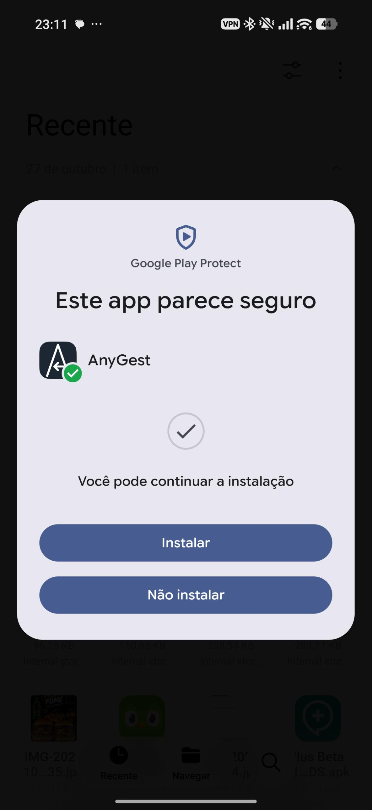

# AnyGest

🇧🇷 Português · 🇺🇸 [English](README.en.md)

App de **gestos de navegação para o HyperOS (Xiaomi, Redmi e POCO)** que deixa você usar
**o launcher que quiser** (Nova, Niagara, Lawnchair...) sem perder os gestos — e ainda abre o
**Circule para pesquisar** com toque longo na alça de navegação, igual ao sistema. Funciona
**sem root, sem Shizuku, sem ADB e sem computador**: é um app só.

**[⬇️ Baixar o APK mais recente](https://github.com/VictorEsidoro/AnyGest/releases/latest/download/anygest.apk)**
· [todas as versões](https://github.com/VictorEsidoro/AnyGest/releases) ·
[novidades](CHANGELOG.md)

> **AnyGest**, por **Victor Eduardo ([@victoresidoro](https://github.com/VictorEsidoro))** —
> baseado no [HyperGesture](https://github.com/h3nc4/HyperGesture), de **Henrique Almeida
> ([h3nc4](https://github.com/h3nc4))**. Veja em [Créditos](#créditos) quem fez o quê.
>
> **Já usava o HyperGesture?** O AnyGest é um app novo para o Android (pacote diferente), então
> **não atualiza por cima**: desinstale o HyperGesture uma vez antes de instalar o AnyGest, para
> os gestos não ficarem em dobro. As configurações não são levadas, mas refazer leva poucos
> minutos.

## O problema que ele resolve

O HyperOS amarra a navegação por gestos ao launcher da própria Xiaomi. Se você troca para o
Nova, o Niagara ou o Lawnchair, os gestos de tela cheia param de funcionar e o celular volta
para a **barra de três botões**, sem jeito de religar. O AnyGest devolve os gestos.

## O que o app faz

| Gesto | O que faz |
|---|---|
| Deslizar a partir da **borda esquerda ou direita** | Voltar |
| Deslizar **de baixo para cima** | Tela inicial |
| Deslizar de baixo para cima **e segurar** | Apps recentes |
| Deslizar **para os lados na borda inferior** *(opcional)* | Trocar para o app anterior / próximo |
| **Tocar e segurar no meio da borda inferior** *(opcional)* | **Circule para pesquisar** |

E também:

- **Tudo ajustável**: largura da borda, distância do gesto, tempo de espera e vibração (leve, normal ou forte), com backup das configurações.
- **Em português e inglês**, com seletor de idioma dentro do app.
- **Leve**: cerca de 2,5 MB, sem internet, sem anúncios, sem coletar nada.

## O que o AnyGest adiciona ao HyperGesture

- **Circule para pesquisar com toque longo na alça de navegação**, sem root e sem nenhum
  outro app (antes era preciso combinar o MiCTS com um app de gestos).
- **Comportamento idêntico ao do sistema**: o toque longo usa os mesmos valores que o Android
  usa na alça original — o **Atraso ao tocar e pressionar** que você escolheu em
  Acessibilidade, a mesma tolerância de movimento e a mesma área (só sobre a alça, no centro).
  Toques longos no resto da borda continuam chegando normalmente ao app que está embaixo.
- **Tradução completa para português do Brasil**, com os nomes de telas **exatamente** como
  aparecem no HyperOS 3, para você achar cada opção sem adivinhar.
- **Seletor de idioma**: Automático (português se o telefone estiver em português, inglês nos
  outros casos), Português (Brasil) ou English.
- **Primeiros passos dentro do app**: uma lista em ordem, com cores (vermelho pendente, verde
  feito, amarelo para conferir), que leva a cada tela do sistema e só libera o próximo passo
  quando o anterior está feito.
- **Atalho no Centro de controle**: mostra se os gestos estão funcionando e, se o HyperOS parar
  o serviço com a barra de botões escondida, leva direto à Acessibilidade — sem reiniciar.
- **Segundo atalho no Centro de controle, pra navegação**: se a barra de botões voltar sozinha,
  abre a tela de modo de navegação do HyperOS num toque. Não troca o modo sozinho — isso é
  restrito ao sistema — só poupa a procura.
- **Créditos** dentro do app e versões publicadas aqui com o `.apk` direto, sem zip.

A lista completa, versão por versão, está no [CHANGELOG.md](CHANGELOG.md).

---

## Como colocar para funcionar (passo a passo para não programadores)

O app não está na Play Store, então você instala o arquivo `.apk` manualmente. São poucos
passos e você só faz uma vez.

### Passo 1 — Baixar e instalar

1. No celular, toque em **[Baixar o APK mais recente](https://github.com/VictorEsidoro/AnyGest/releases/latest/download/anygest.apk)**.
2. Abra o arquivo `anygest.apk` baixado e toque em instalar.

> ✅ **Apareceu uma tela do Play Protect dizendo "Este app parece seguro", com um botão
> Instalar?** Então está tudo certo, é só tocar em **Instalar**: o Play Protect já escaneou o
> APK e liberou. Esse é o caso mais comum.
>
> 
>
> ⚠️ **Apareceu só "O app não foi instalado", sem dizer o porquê? Quase certo que é o Play
> Protect.** Na **primeira vez** que um app novo é instalado fora da loja, o Play Protect pode
> barrá-lo e o Android mostra só essa mensagem, sem o aviso de "parece seguro" acima. Não é erro
> do arquivo nem da assinatura, e acontece mesmo com o APK baixado direto do GitHub. O jeito de
> resolver:
>
> 1. Abra a **Play Store**, toque na sua **foto de perfil** → **Play Protect** → engrenagem ⚙️.
> 2. Desligue **Analisar apps com o Play Protect** *(os nomes podem variar um pouco conforme a
>    versão)*.
> 3. Instale o AnyGest.
> 4. **Volte a ligar** o Play Protect.
>
> Depois de instalado, as atualizações do AnyGest não dão esse problema.
>
> **Estava com o HyperGesture instalado?** Desinstale-o antes (Configurações → Apps →
> HyperGesture → Desinstalar). Os dois ligados ao mesmo tempo podem fazer cada gesto disparar duas vezes.
>
> **Mandou o arquivo pelo WhatsApp?** Às vezes o arquivo chega alterado e a instalação falha
> com "O app não foi instalado". Baixe direto pelo link acima ou passe pelo Google Drive.

### Passo 2 — Seguir os Primeiros passos do app

Abra o AnyGest. O card **Primeiros passos**, no topo, mostra o que falta, em ordem, e cada
passo tem um botão que abre a tela certa do sistema:

| Cor | Significa |
|---|---|
| 🔴 Vermelho | Obrigatório e ainda não feito |
| 🟢 Verde | Feito |
| 🟡 Amarelo | O app não consegue conferir sozinho: confira e toque em **Já fiz** |
| ⚪ Cinza | Bloqueado até o passo anterior |

Os passos essenciais, na ordem:

1. **Permitir configurações restritas** — Configurações → Apps → AnyGest →
   **Informações do app** → seção **Configurações avançadas** → ative **Permitir configurações
   restritas**. Sem isso o Android não deixa ligar a Acessibilidade. **Pular este passo é o
   motivo mais comum de o app parecer não fazer nada.** A opção só aparece enquanto ainda não
   foi liberada.
2. **Ligar o AnyGest** — **Acessibilidade** → **AnyGest** → ative **Usar
   AnyGest**.
3. **Economia de bateria: Nenhuma restrição** — em **Informações do app** → **Energia**, na
   seção **Economia de bateria**, escolha **Nenhuma restrição**.
4. **Início automático em segundo plano** — ative para o AnyGest, para os gestos voltarem
   sozinhos depois de reiniciar.

O HyperOS costuma encerrar apps em segundo plano para economizar bateria — e quando isso
acontece com um app de Acessibilidade, a permissão é desligada junto. Os passos 3 e 4 evitam
isso. *(Opcional)* Na tela de apps recentes, segure o card do AnyGest e toque no
**cadeado**, para o "Limpar tudo" não fechá-lo.

Quando tudo estiver verde, o card encolhe para **Tudo pronto**. Se o HyperOS parar o serviço
depois, ele abre de novo sozinho, mostrando o que refazer. Passos concluídos continuam com o
botão para a tela do sistema, e um passo marcado com **Já fiz** pode ser desmarcado.

### Passo 3 — Adicionar o atalho no Centro de controle *(recomendado)*

No card **Atalho no Centro de controle**, toque em **Adicionar ao Centro de controle**.

Por que ele importa: se o HyperOS parar o serviço de gestos com a barra de botões escondida,
você fica sem Voltar e sem Início, e a única saída seria reiniciar o celular. O Centro de
controle continua abrindo ao deslizar do topo da tela, e o atalho mostra se os gestos estão
funcionando. Se estiverem parados, um toque nele abre direto a página do AnyGest em
Acessibilidade para religar.

Se o botão não aparecer ou não fizer nada, edite o Centro de controle e adicione o atalho do
AnyGest manualmente.

Há um segundo atalho opcional, no card **Atalho no Centro de controle (navegação)**: se a
barra de botões voltar sozinha (ver [Problemas comuns](#problemas-comuns)), ele abre a tela de
modo de navegação do HyperOS num toque. Só aparece em aparelhos HyperOS.

### Passo 4 — Ativar o Circule para pesquisar *(opcional)*

1. No app, no card **Circule para pesquisar**, ative **Toque longo na borda inferior =
   Circule para pesquisar**.
2. O Google precisa ser o **App assistente digital**. O botão **Assistivo e voz** do próprio
   card abre a tela certa.
3. Pronto: toque e segure no meio da borda inferior. O celular vibra e o Circule para
   pesquisar abre.

### Passo 5 — Esconder a barra de botões *(opcional)*

O card **Barra de botões** mostra se a barra está escondida e leva até a tela do sistema onde
você pode escolher **Navegação por gestos** e esconder a barra de três botões para ganhar
espaço. Ele só libera depois que o AnyGest estiver ligado: barra escondida sem gestos deixa
você sem como navegar. Com launcher de terceiros, os gestos que funcionam continuam sendo os do
AnyGest — é só uma questão de espaço na tela.

---

## Conhecendo o app

| Card | O que você encontra |
|---|---|
| **Primeiros passos** | O que falta para os gestos funcionarem, em ordem e com cores, e um botão para cada tela do sistema. Encolhe para "Tudo pronto" quando acaba. |
| **Atalho no Centro de controle** | Por que o atalho importa, se ele já foi adicionado e o botão para adicionar. |
| **Barra de botões** | Se a barra está escondida, e o atalho para o Modo de navegação. Só libera com o AnyGest ligado. |
| **Troca de apps** | Liga o deslize lateral na borda inferior. Pede o acesso aos **Dados de uso do app**. |
| **Circule para pesquisar** | Liga o toque longo na alça e permite usar um tempo manual em vez do do sistema. |
| **Seus gestos** | Um lembrete do que cada gesto faz. |
| **Idioma do app** | Automático, Português (Brasil) ou English (Android 13 ou mais novo). |
| **Configurações dos gestos** | Larguras, distâncias, tempos e vibração (leve, normal ou forte). Também exporta e importa as configurações num arquivo, para guardar ou levar a outro celular. Fica recolhido para um toque sem querer não mexer em nada. |
| **Diagnóstico** | Detalhes do aparelho e o último erro. Útil para relatar problemas — nada sai do celular. |
| **Créditos** | Quem fez o app e de onde vem cada parte. |
| **O atalho em si** (no Centro de controle) | Fora do app: mostra se os gestos estão ativos e leva à Acessibilidade se não estiverem. |

---

## Privacidade

- **Sem internet**: o app não tem permissão de acesso à rede. Nada sai do seu celular.
- **Acessibilidade usada só para navegar**: o serviço observa toques em faixas finas nas bordas
  da tela. **Não lê** o conteúdo da tela, textos ou o que você digita.
- **Dados de uso do app** só são pedidos se você ligar a troca de apps, para saber qual foi o
  app anterior.
- **Circule para pesquisar**: ao abrir, quem lê a tela é o **app Google** — exatamente como
  acontece quando você usa o gesto da alça no launcher da Xiaomi. O AnyGest só pede para
  ele abrir.

---

## O que ele não consegue fazer

- **Não liga os gestos nativos do HyperOS.** Isso depende de permissões que só o sistema tem.
  O AnyGest faz os gestos por conta própria.
- **A animação de abrir e fechar apps** (o app "encolhendo" de volta para o ícone) é do sistema
  e só funciona completa com o launcher da Xiaomi. Com outro launcher, a transição é a padrão
  do Android.
- **O Circule para pesquisar depende do Google**: precisa do app Google como assistente digital
  e de o recurso estar liberado para o seu aparelho.

---

## Problemas comuns

| Sintoma | O que fazer |
|---|---|
| "O app não foi instalado" | Primeiro, **desligue o Play Protect só para instalar** (veja o aviso no Passo 1): na primeira instalação ele costuma barrar e a mensagem não diz o motivo. Se veio pelo WhatsApp, baixe de novo pelo link ou pelo Drive. Se já tinha uma versão de **teste (debug)** instalada, desinstale antes — a assinatura é diferente. |
| Cada gesto parece disparar duas vezes | Provavelmente o HyperGesture antigo ainda está instalado e ligado. Desinstale-o: o AnyGest é outro app e não o substitui sozinho. |
| A chave de Acessibilidade não liga | Faltou **Permitir configurações restritas** (primeiro item dos Primeiros passos). |
| Os gestos param sozinhos / a Acessibilidade desliga | Confira os itens de Economia de bateria e Início automático nos Primeiros passos. Se aparecer "serviço com mau funcionamento", desligue e ligue de novo o AnyGest em Acessibilidade. |
| Os gestos pararam e a barra de botões está escondida | Deslize do topo para abrir o Centro de controle e toque no atalho do AnyGest: ele abre a Acessibilidade para religar. |
| A barra de botões voltou sozinha, mas os gestos continuam ligados | O HyperOS mudou o modo de navegação por conta própria (normal com launchers de terceiros). Toque no segundo atalho do Centro de controle (navegação) pra ir direto à tela e escolher Navegação por gestos de novo. |
| O Circule para pesquisar não abre | Confira se o Google é o **App assistente digital** (em **Assistivo e voz**). O motivo do erro aparece em **Diagnóstico → Última falha**. |
| Toque longo na borda abre o Circule para pesquisar sem querer | Ele só vale no centro, sobre a alça. Se ainda atrapalhar, desligue **Usar o Atraso ao tocar e pressionar do sistema** e aumente o tempo manual. |
| Toques perto da borda de baixo parecem um pouco lentos | É esperado: o app precisa "segurar" cada toque na borda para ver se vira gesto. Diminuir a **Largura da área de ativação** reduz a área afetada. |
| Um gesto dispara sem querer ou não dispara | Ajuste a distância do deslize daquela borda em **Configurações dos gestos**. |

---

## Créditos

- **Victor Eduardo ([@victoresidoro](https://github.com/VictorEsidoro))** — idealizou e conduziu
  o AnyGest, baseado no HyperGesture, e reformulou o app:
  - o Circule para pesquisar com toque longo na alça de navegação, sem root e sem outro app;
  - o ajuste aos valores do próprio sistema (Atraso ao tocar e pressionar, tolerância de
    movimento e área da alça) para uma navegação tão fluida quanto a original;
  - uma vibração só por gesto;
  - um serviço mais leve na bateria, que só acorda quando você toca na borda;
  - a lista de Primeiros passos, em ordem e com cores, que guia toda a configuração;
  - o atalho no Centro de controle, para religar os gestos sem reiniciar o celular;
  - a proteção que só deixa esconder a barra de botões com os gestos ligados;
  - a tradução para português do Brasil com os nomes reais das telas do HyperOS, e o seletor
    de idioma;
  - o nome, o pacote e o ícone próprios do AnyGest;
  - as versões publicadas com o APK direto, o changelog e a documentação.
- **[HyperGesture](https://github.com/h3nc4/HyperGesture)**, de **Henrique Almeida
  ([h3nc4](https://github.com/h3nc4))** — criou o app em que o AnyGest se baseia: os gestos, a
  captura de toques nas bordas, a troca de apps, as telas e toda a base sobre a qual ele foi
  construído. Depois do fork, contribuiu direto para o AnyGest:
  - o cancelamento do Voltar revertido — trazer o dedo de volta para a borda antes de soltar
    cancela o gesto, em vez de voltar, e empurrar de novo o rearma;
  - a correção do atalho do Centro de controle que, com os gestos desligados, podia não fazer
    nada ao ser tocado em vez de abrir a Acessibilidade.
- **[MiCTS](https://github.com/parallelcc/MiCTS)**, de **parallelcc**, e
  **[CTSLauncher](https://github.com/chenxiaolong/CTSLauncher)**, de **chenxiaolong** — mostraram
  como abrir o Circule para pesquisar **sem root**, conversando direto com o serviço de
  assistente do Android. A técnica usada aqui é a deles.
- **[Material Symbols](https://fonts.google.com/icons)**, do Google (licença Apache 2.0) — os ícones
  de traço fino dos cards do app.
- Desenvolvido com a ajuda do **Claude** (Anthropic).

Os três projetos são software livre sob a licença **GPL-3.0**, e o AnyGest também.

---

## Para desenvolvedores

Projeto Android em **Kotlin + Jetpack Compose**, com o reconhecimento de gestos isolado em
código puro (sem tipos do Android) para ser testado na JVM. O passo a passo de build, testes e
depuração no aparelho está em [`docs/development.md`](docs/development.md), e o que o HyperOS
permite ou não sobre a barra de navegação está em
[`docs/hyperos-navigation.md`](docs/hyperos-navigation.md).

No AnyGest, o workflow [`fork-apk.yaml`](.github/workflows/fork-apk.yaml) roda os testes e o
lint, gera o APK release assinado e publica um Release com o `.apk` sempre que o `versionName`
muda. Branches `dev/...` passam pelos mesmos testes e geram o APK para baixar em Actions, sem publicar release. A assinatura usa os segredos `ANDROID_KEYSTORE_B64` e `KEYSTORE_PASSWORD`, os mesmos
nomes do projeto original.

---

## Licença

O AnyGest é software livre, baseado no HyperGesture: você pode redistribuí-lo e/ou
modificá-lo sob os termos da
**GNU General Public License**, versão 3 ou (a seu critério) qualquer versão posterior, como
publicada pela Free Software Foundation. É distribuído **sem nenhuma garantia**. Veja o texto
completo em [LICENSE](LICENSE).

Copyright (C) 2026 Victor Eduardo (@victoresidoro) — AnyGest.
Copyright (C) 2026 Henrique Almeida &lt;me@h3nc4.com&gt; — HyperGesture, o código original.
